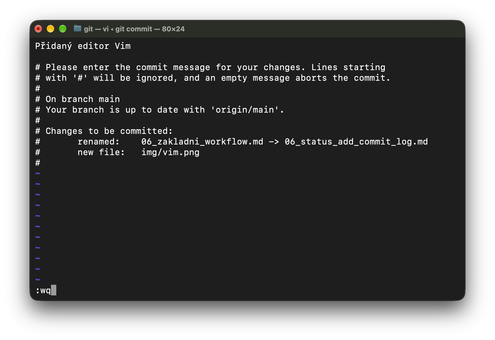

# Základní workflow

```
git status
git add
git commit
git log
```

---

Všechny činnosti se provádějí **vždy v adresáři s repozitářem**!!!

```bash
cd nazev_repozitae
```

Kontrola stavu:

```bash
git status
```

Krátká verze:

```bash
git status -s
```

Nejčastější stavy:

- `??` .. nový nesledovaný soubor
- `A` .. přidaný soubor
- `M`	.. upravený soubor
- `D` .. smazaný soubor
- `R` .. přejmenovaný soubor

Přidání změn do **Stage**:

Jeden soubor:

```bash
git add index.html
```

Všechny soubory:

```bash
git add -A
```

Vytvoření **commitu** (verze, revize):

```bash
git commit -m "Přidána úvodní stránka"
```


Pokud zapomenete zadat komentář (parametr `-m`), Git otevře textový editor, ve kterém můžete komentář doplnit.

1. Na první řádek napište komentář commitu, např. `Přidána úvodní stránka`.
2. Uložte soubor a zavřete editor.

Pokud se otevře editor Vim:



- Stiskněte `i` (přechod do režimu psaní).
- Napište komentář.
- Stiskněte `Esc`.
- Napište `:wq` a stiskněte `Enter` (uložení a ukončení).

Pokud komentář nechcete zadat a commit zrušit, v editoru Vim napište `:q!` a stiskněte `Enter`.

---

## Základní workflow

```bash
git status
git add -A
git commit -m "Popis změn"
```

Zapamatovat si: **upravím → add → commit** a tak stále dokola.

**Poznámka:** V reálném projektu vytvářet commity **po dokončení nějaké ucelené změny** a ne po každém napsaném řádku. Nebo si jednoduše nastavíte jiná nějaká rozumná "pravidla hry". Např. 2&times; denně, večer, jednou za hodinu... Důležitý je hlavně smysluplný komentář.

---

U příkazu `git add` doporučuji přepínač `-A` (nebo `--all`, což je to samé). Přidá **všechny změny v celém repozitáři bez ohledu na aktuální složku**. To znamená méně překvapení a méně dotazů typu: "Proč se mi ten soubor neuložil do commitu?"

Naopak `git add .` přidá nové, změněné i smazané soubory **jen od aktuální složky dolů**. 
 
## Praktický příklad

Opravíte soubory:

```
index.html
css/style.css
```

Potom se přepnete do:

```bash
$ cd css
```
a zadáte:

```bash
$ git add .
$ git commit -m "Úprava webu"
```

Výsledek:

- `css/style.css` se do commitu přidá 
- `index.html` se do commitu **nepřidá**

Commit tedy neobsahuje všechny změny.

Když místo toho použijete:

```bash
$ git add -A
$ git commit -m "Úprava webu"
```

uloží se vše.

---

## Výpis historie commitů

Historii projektu zobrazíte příkazem:

```bash
git log
```

Git vypíše všechny commity od nejnovějšího po nejstarší. U každého commitu zobrazí:

- commit hash,
- autora,
- datum a čas vytvoření,
- zprávu commitu.

Příklad:

```text
commit e566ffcc3007ce7f9bf76217a8f963c78095d30e
Author: Jiří Machač <machac@panska.cz>
Date:   Tue Dec 13 15:06:04 2024 +0100

    Přidaný titulek webu
```

Výpis může být delší. Pro pohyb použijte šipky na klávesnici. Pro ukončení stiskněte klávesu `Q` (*Quit*).


### Zkrácená historie

Pro běžnou práci bývá praktičtější jednořádkový výpis:

```bash
git log --oneline
```

Příklad:

```text
e566ffc (HEAD -> main) Přidaný titulek webu
d5777d1 Vytvoření externího CSS
e20ee59 Lokalizace webu do CZ
d747969 První verze webu
```

Význam jednotlivých částí:

- `e566ffc` - zkrácený commit hash,
- `HEAD` - aktuální commit,
- `main` - aktivní větev,
- `Přidaný titulek webu` - zpráva commitu.

Příkaz `git log --oneline` poskytuje rychlý přehled historie projektu a patří mezi nejčastěji používané gitové příkazy.


