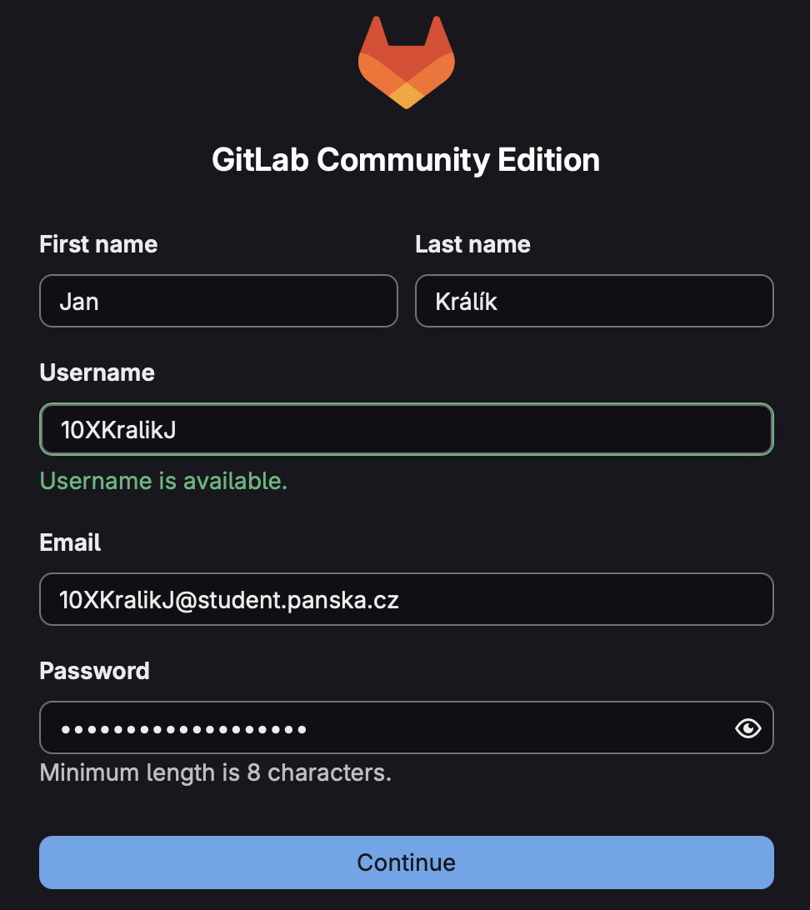

# GitLab

GitLab je komplexní platforma pro správu zdrojového kódu založená na systému Git. Umožňuje efektivní spolupráci na projektech díky verzování kódu, přehledné historii změn (commity) a dalším nástrojům pro organizaci práce. Z hlediska běžného používání je funkčně velmi podobný službě GitHub a pracuje se v něm na stejných principech.

Umožňuje:

- ukládat repozitáře na server,
- zálohovat zdrojové kódy,
- spolupracovat v týmu,
- spravovat přístupová oprávnění,
- vytvářet **Issues** a **Merge Requests**.

Pro výukové účely ve škole používáme vlastní server s platformou **GitLab Community Edition** (GitLab CE), který nám poskytuje plnou kontrolu nad projekty i uživatelskými účty a **umožňuje bezpečnou práci v interním školním prostředí**.

- ✅ [https://gitlab.panska.cz](https://gitlab.panska.cz)

- ❌ Neplést s komerčním `GitLab.com`

## Vytvoření účtu

1. Otevřít: [https://gitlab.panska.cz](https://gitlab.panska.cz)
2. Zvolit registraci.
3. Vyplnit:

   - jméno a příjmení,
   - uživatelské jméno **ve tvaru** `10XPrijmeniJ` (v rámci systému musí být unikátní)
   - **školní e-mail** `10XPrijmeniJ@student.panska.cz` (jiný než školní nebude fungovat)
   - vhodné heslo, klidně vaše školní.

4. Potvrdit registrační e-mail.

---

Jakmile pochopíte základní principy práce v GitLabu, budete se umět bez potíží orientovat i na GitHubu. Obě služby totiž fungují na stejném systému Git a práce s nimi je v podstatě totožná. Naučíte se pracovat s repozitáři, ukládat změny, vracet se v historii a spolupracovat s ostatními, a tyto dovednosti pak můžete použít kdekoliv jinde. Rozdíly mezi GitLabem a GitHubem jsou hlavně v ovládání a v některých doplňkových funkcích, které pro základní použití nejsou podstatné. Co se naučíte zde, není vázané na jednu konkrétní službu, ale obecná a přenositelná dovednost. Vše navíc probíhá v bezpečném školním prostředí.

