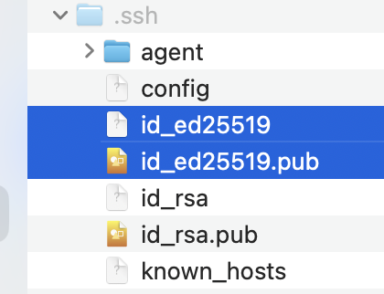

# Propojení s počítačem (SSH klíče)

Pro plnohodnotnou spolupráci mezi lokálním Git repozitářem a GitLab serverem je potřeba si nejprve vygenerovat šifrovací klíče - **soukromý** a **veřejný**. 

- soukromý umí text zašifrovat i rozšifrovat
- veřejný pouze zašifrovat

Jak to funguje (zjednodušeně):

1. Klient pošle požadavek na ověření.
2. Server vygeneruje jednorázový náhodný řetězec znaků (např. `7F9A2C81...`), **zašifruje ho veřejným klíčem** a pošle klientovi.
3. Klient zprávu **soukromým klíčem rozšifruje** a odešle zpět na server. 
4. Server oba řetězce porovná, a pokud souhlasí, je identita ověřena.

---

⚠️ Pro správnou funkčnost **musí být e-mail lokálního Git repozitáře stejný s GitLabem** - tedy váš školní. Před pokračováním zkontrolujte, popř. nastavte školní. Jinak nebude propojení na GitLab fungovat! Tento požadavek platí i pro GitHub.

Na počítači si vygenerujte **pár šifrovacích klíčů** (dva textové soubory). Jeden je **privátní** - zůstává uložený v počítači, druhý je **veřejný**. Ten se nakopíruje na server. GitLab podporuje [několik typů klíčů](https://docs.gitlab.com/18.6/user/ssh/). My použijeme preferovaný typ **ED25519**. Používá jej i GitHub.

🌐 Dokumentace: [https://docs.gitlab.com/19.6/user/ssh/](https://docs.gitlab.com/19.6/user/ssh/)

## Krok 1: Generování klíčů

```bash
ssh-keygen -t ed25519 -C "10XPrijmeniJ@student.panska.cz"
```
Všechny otázky potvrďte klávesou **Enter**, heslo ke klíči nevytvářejte.

**Výchozí umístění:**

```
~/.ssh/id_ed25519
~/.ssh/id_ed25519.pub
```

Soukromý klíč má po vygenerování automaticky nastavená práva pouze pro majitele (`600`, `-rw-------`). Nikdo jiný se k němu nedostane:




## Krok 2: Zobrazení veřejného klíče

Linux/macOS (v terminálu):
```
cat ~/.ssh/id_ed25519.pub
```
Windows (v PowerShellu):
```
type ~/.ssh/id_ed25519.pub
```

## Krok 3: Přidání klíče do GitLabu

1. GitLab: **Profile** → **Preferences** → **SSH Keys**
2. Vložit obsah souboru `id_ed25519.pub`
3. Do pole **Title** je dobré zapsat název počítače/učebny
4. Kliknout na **Add Key**

## Krok 4: Test spojení

```bash
ssh -T git@gitlab.panska.cz
```

**První spuštění na daném počítači** vyvolá potřebu povolit připojení "neznámého počítače":

```
$ ssh -T git@gitlab.panska.cz
The authenticity of host 'gitlab.panska.cz (2a02:b20:100:217::11)' can't
be established.
ED25519 key fingerprint is SHA256:YFpk0s/GcyP9gDFxgicZ534O9Ehy0T37pWMi8.
This key is not known by any other names.
Are you sure you want to continue connecting (yes/no/[fingerprint])?
```

Zapište **yes** a potvrďte. Tím se zapíše do souboru `~/.ssh/know_hosts`. Druhé (a další) už vypíše:

```
$ ssh -T git@gitlab.panska.cz
Welcome to GitLab, @10XPrijmeniJ!
```

## Nejčastější problémy při ověřování SSH klíče

Pokud se po příkazu `ssh -T git@gitlab.panska.cz` nevypíše hláška `Welcome to GitLab, @10XPrijmeniJ!`, zkontrolujte následující:

| Problém | Řešení |
|---|---|
| SSH požaduje heslo (`git@gitlab.panska.cz's password:`) | SSH klíč není správně použit. Zkontrolujte, zda jste do GitLabu vložili **veřejný klíč** (`.pub`) a zda je správně uložen. Heslo k účtu GitLab zde nezadávejte. |
| SSH požaduje heslo ke klíči (`Enter passphrase`) | Pokud jste při vytváření klíče zadali heslo, zadejte jej. Nejde o heslo ke GitLabu. |
| `Permission denied (publickey)` | GitLab klíč odmítl. Zkontrolujte, zda jste přidali správný veřejný klíč a zda odpovídá klíči uloženému v počítači. |
| `Could not resolve hostname` | Zkontrolujte připojení k internetu a správnost adresy serveru. |
| `Connection timed out` | Server není dostupný nebo je spojení blokováno sítí či firewallem. |

**Správný výsledek:** 

```text
Welcome to GitLab, @10XPrijmeniJ!
```
