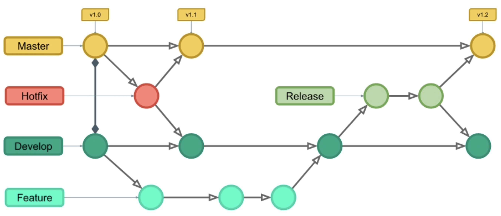

# Větve



Větve vám umožní pracovat na různých částech projektu, jako jsou nové funkce nebo opravy chyb, aniž byste zasahovali do hlavní větve.

Běžné důvody pro vytvoření větve:

- Vývoj nové funkce
- Oprava chyby
- Experimentování s nápady

**Příklad:** Řekněme, že máte webový projekt většího rozsahu a potřebujete na něm aktualizovat obsah i vzhled. Jak by to fungovalo bez Gitu a s Gitem:

Bez Gitu:

- Vytvoříte si kopie všech souborů, které chcete upravit.
- Začněte pracovat a zjistěte, že kód závisí na kódu v jiných souborech, které je také potřeba změnit!
- Uděláte si také kopie těchto závislých souborů.
- URGENTNÍ OPRAVA! Někde jinde v projektu je nesouvisející chyba, kterou je třeba co nejdříve opravit!
- Uložíte si všechny soubory a poznamenáte si názvy kopií, na kterých jste pracovali.
- Pracujte na nesouvisející chybě a aktualizujte kód, abyste jej opravili.
- Vrátíte se k návrhu a dokončíte práci tam.
- Zkopírujete kód nebo přejmenujete soubory, aby aktualizovaný kód byl v živé verzi.
- Po dvou týdnech si uvědomíte, že nesouvisející chyba nebyla opravena v nové verzi, protože jste soubory zkopírovali před opravou.


S Gitem:

- U nové větve nazvané \verb|novy-vzhled| upravujte kód přímo, aniž byste ovlivnili hlavní větev.
- URGENTNÍ OPRAVA! Někde jinde v projektu je nesouvisející chyba, kterou je třeba co nejdříve opravit!
- Vytvoříte novou větev z hlavního projektu nazvanou \verb|mala-oprava|.
- Opravíte nesouvisející chybu a sloučíte větev s malou opravou chyby s hlavní větví.
- Vrátíte se do větve pro nový design a dokončíte tam práci
- Sloučíte větev nového designu s hlavní (upozorníte na malou opravu chyby, kterou jste přehlédli).


Větve vám umožní pracovat na různých částech projektu, aniž byste ovlivnili hlavní větev.


Výpis větví:

```bash
git branch
```

Aktivní větev má před názvem `*`. Výchozí a zatím jedinou větví je `main` (nebo `master`).


Vytvoření větve:

```bash
git branch nova-funkce
```

Přepnutí do větve:

```bash
git checkout nova-funkce
```

Vytvoření a okamžité přepnutí:

```bash
git checkout -b nova-funkce
```

Sloučení větví:

⚠️ Pravidlo: Vždy se slučuje jiná větev do aktivní. V příkladu níže **z** větve `nova-funkce` **do** větve `main`.

Nejprve přepnutí:

```bash
git checkout main
```

Poté sloučení:

```bash
git merge nova-funkce
```

Smazání větve:

```bash
git branch -d nova-funkce
```

Log včetně grafu větví:

```bash
git log --oneline --graph --all
```

Ukáže vývoj větví a jejich spojování.

