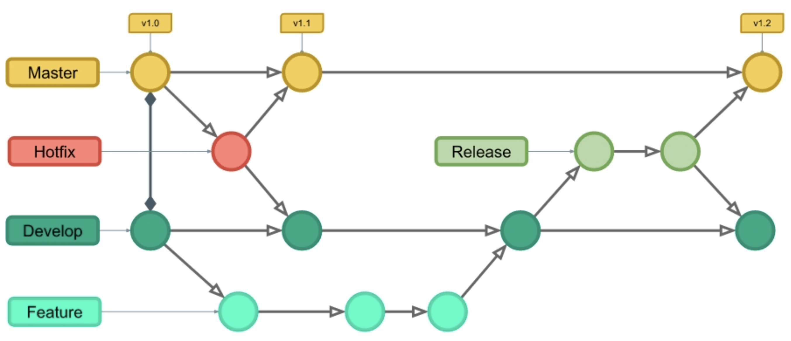

# Větve

```
git branch
git checkout
git merge
git diff
```



Větve vám umožní pracovat na různých částech projektu, jako jsou nové funkce nebo opravy chyb, aniž byste zasahovali do hlavní větve.

Běžné důvody pro vytvoření větve:

- Vývoj nové funkce
- Oprava chyby
- Experimentování s nápady

**Příklad:** Řekněme, že máte webový projekt většího rozsahu a potřebujete na něm aktualizovat obsah i vzhled. Jak by to fungovalo bez Gitu a s Gitem:

Bez Gitu:

- Vytvoříte si kopie všech souborů, které chcete upravit.
- Začněte pracovat a zjistěte, že kód závisí na kódu v jiných souborech, které je také potřeba změnit!
- Uděláte si také kopie těchto závislých souborů.
- URGENTNÍ OPRAVA! Někde jinde v projektu je nesouvisející chyba, kterou je třeba co nejdříve opravit!
- Uložíte si všechny soubory a poznamenáte si názvy kopií, na kterých jste pracovali.
- Pracujte na nesouvisející chybě a aktualizujte kód, abyste jej opravili.
- Vrátíte se k návrhu a dokončíte práci tam.
- Zkopírujete kód nebo přejmenujete soubory, aby aktualizovaný kód byl v živé verzi.
- Po dvou týdnech si uvědomíte, že nesouvisející chyba nebyla opravena v nové verzi, protože jste soubory zkopírovali před opravou.


S Gitem:

- U nové větve nazvané `novy-vzhled` upravujte kód přímo, aniž byste ovlivnili hlavní větev.
- URGENTNÍ OPRAVA! Někde jinde v projektu je nesouvisející chyba, kterou je třeba co nejdříve opravit!
- Vytvoříte **novou větev** z hlavního projektu nazvanou `mala-oprava`.
- Opravíte nesouvisející chybu a sloučíte větev s malou opravou chyby s hlavní větví.
- Vrátíte se do větve pro nový design a dokončíte tam práci.
- Sloučíte větev nového designu s hlavní (v commitu upozorníte na malou opravu chyby, kterou jste přehlédli).


==Větve vám umožní pracovat na různých částech projektu, aniž byste ovlivnili hlavní větev.==


Výpis větví:

```bash
git branch
```

Aktivní větev má před názvem `*`. Výchozí a zatím jedinou větví je `main` (nebo `master`).


Vytvoření větve:

```bash
git branch nova-funkce
```

Přepnutí do větve:

```bash
git checkout nova-funkce
```

Vytvoření a okamžité přepnutí:

```bash
git checkout -b nova-funkce
```

## Sloučení větví

⚠️ Pravidlo: Vždy se slučuje jiná větev do aktivní. V příkladu níže **z** větve `nova-funkce` **do** větve `main`.

Nejprve přepnutí:

```bash
git checkout main
```

Poté sloučení:

```bash
git merge nova-funkce
```

Smazání větve:

```bash
git branch -d nova-funkce
```

Log včetně grafu větví:

```bash
git log --oneline --graph --all
```

Ukáže vývoj větví a jejich spojování.

## Tři možné stavy slučování

Příkaz `git merge` může skončit jedním z těchto stavů:

### Fast forward

Změny byly provedeny pouze ve vedlejší větvi. Spučením se pouze posune ukazatel `HEAD` podle nejnovějšího commitu.

### True merge

Změny byly provedeny jak v hlavní, tak vedlejší větvi. Sloučení je spojí - zahrne změny z obou větví.

### Aborted merge

Změny byly provedeny jak v hlavní, tak vedlejší větvi. Sloučení ovšem selže, neboť minimálně jedna změna se týká **stejného řádku kódu souboru jak v hlavní, tak vedlejší větvi**. Git nemůže rozhodnout, kterou z těch změn má zachovat a kterou zahodit. Tím vznikne tzv. "konflikt". Příklad:

Mějme soubor se styly `styly.css` ve větvi `main` s tímto obsahem:

```css
h1 {
  font-family: arial;
  color: navy;
}
```

V nové větvi `novy-vzhled` upravíme soubor takto:

```css
h1 {
  font-family: arial;
  color: yellow;
}
```

Pokus o merge skončí konfliktem:

```
$ git merge novy-vzhled
Auto-merging styly.css
CONFLICT (content): Merge conflict in styly.css
Automatic merge failed; fix conflicts and then commit the result.
```

Výpis příkazem `git diff` zjistíme, kde je chyba:

```
$ git diff
diff --cc styly.css
index 241cc8b,18d8f2f..0000000
--- a/styly.css
+++ b/styly.css
@@@ -1,4 -1,5 +1,9 @@@
  h1 {
    font-family: arial;
++<<<<<<< HEAD
 +  color: yellow;
++=======
+   color: navy;
++>>>>>>> novy-vzhled
  }
+ 
```

Jediným způsobem je ručně opravit konfliktní řádky přímo v souboru `styly.css`:

```
h1 {
  font-family: arial;
<<<<<<< HEAD
  color: yellow;
=======
  color: navy;
>>>>>>> novy-vzhled
}
```

např. takto:

```css
h1 {
  font-family: arial;
  color: navy;
}
```

a standardně dokončit commit:

```bash
$ git add -A
$ git commit -m "komentář"
```

`git log` pak může vypadat např. takto:

```
$ git log --oneline --graph
*   158e504 (HEAD -> main) oprava barvy nadpisu
|\  
| * ae50072 (novy-vzhled) změna barvy nadpisu
* | dcf01ca změna barvy nadpisu
|/  
* 6dcf78b přebarvený nadpis
* 4f6f79f výchozí vzhled
```

Konflikt není chyba. Git pouze potřebuje, aby uživatel rozhodl, která verze obsahu má být zachována.
