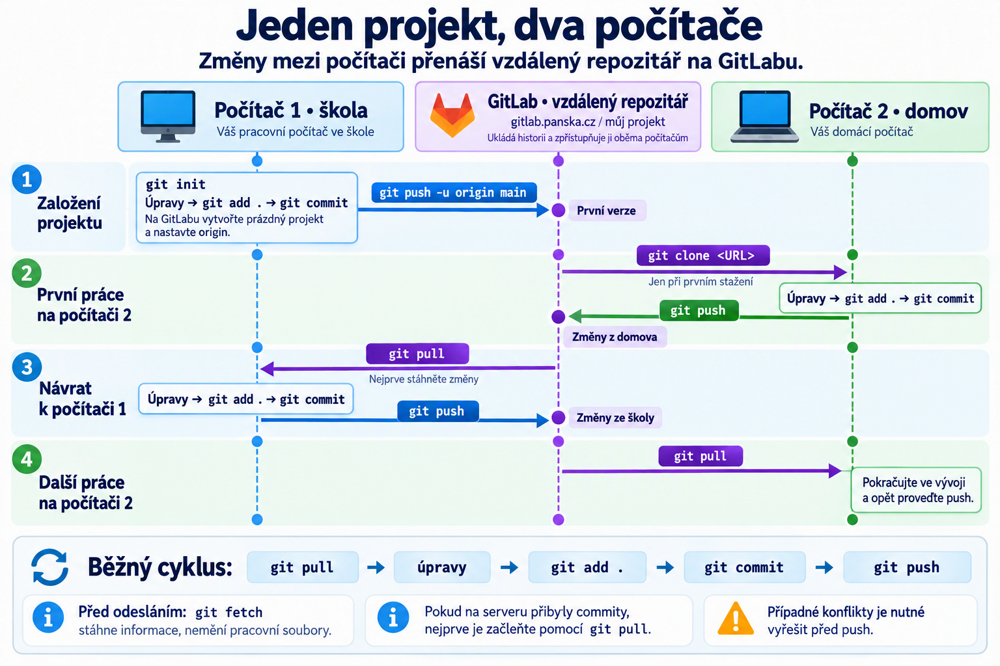

# Průběžná synchronizace

Tato činnost vyžaduje **dodržovat zavedený postup**. Před odesláním změn je **vždy doporučeno nejprve zjistit stav vzdáleného repozitáře**. Předcházíte tím pozdějším konfliktům.

Jako vždy se vše provádí uvnitř repozitáře:

```bash
cd nazev_repozitare
```

Příkaz `git fetch` stáhne z vzdáleného repozitáře nové změny a informace o nich, ale nemění naše pracovní soubory ani aktuální větev. Příklad:

```bash
$ git fetch
remote: Enumerating objects: 50, done.
remote: Counting objects: 100% (50/50), done.
remote: Compressing objects: 100% (41/41), done.
remote: Total 41 (delta 25), reused 0 (delta 0), pack-reused 0 (from 0)
Unpacking objects: 100% (41/41), 71.88 KiB | 1.47 MiB/s, done.
From https://github.com/edumach/git
   b7d08a1..609c178  main       -> origin/main
```

- První část výpisu informuje o stahování a zpracování dat (objektů), která Git potřebuje.
- From `https://github.com/edumach/git` – zdrojový vzdálený repozitář.
- `b7d08a1..609c178` – vzdálená větev se posunula z původního commitu na nový.
- `main -> origin/main` – Git aktualizoval svou evidenci vzdálené větve origin/main (nově ukazuje na commit 609c178).

**Důležité:** Změny jsou nyní stažené, ale ještě nejsou začleněné do naší lokální větve main. K tomu slouží například `git pull` nebo `git merge`.

Pokud příkaz nic nevypíše, žádné změny ve vzdálením repozitáři nejsou. Pokud ano, příkaz vypíše jaké. 


Může nastat jeden ze dvou stavů:

**(1)** lokální i vzdálený repozitář je stejný,

**(2)** vzdálený se od lokálního liší (např. nějakou předchozí synchronizací z jiho počítače). V tomto případě nejprve synchronizujte vzdálený do lokálního. Příkaz `pull` stáhne a sloučí změny:

```bash
git pull
```
nebo

```bash
git pull origin main
```

Příklad:

```bash
$ git pull
Updating b7d08a1..609c178
Fast-forward
 03_instalace.md                     |  11 ++++++--
 10_markdown.md                      |   9 ++++--
 11_GitLab.md                        |   2 +-
 12_GitLab_autentizace.md            |  55 +++++++++++-------------------------
 14_GitLab_viditelnost_repozitare.md |   4 ++-
 15_GitLab_prubezna_synchronizace.md |   7 +++--
 18_GitLab_fork.md                   |   2 +-
 img/viditelnost1.png                | Bin 0 -> 23401 bytes
 img/viditelnost2.png                | Bin 0 -> 37486 bytes
 9 files changed, 41 insertions(+), 49 deletions(-)
 create mode 100644 img/viditelnost1.png
 create mode 100644 img/viditelnost2.png
```


Teprve pak odešlete vaše lokální commity na server:


```bash
git push
```

nebo

```bash
git push origin main
```

---

## Řešení chyby `non-fast-forward` při `git push`

Při pokusu o odeslání změn pomocí `git push` se může objevit chyba:

```
! [rejected] main -> main (non-fast-forward)
error: failed to push some refs
```

Tato chyba znamená, že vzdálená větev obsahuje novější změny, které nejsou ve vaší lokální kopii. Git proto odmítne změny odeslat, aby nedošlo k přepsání historie.

**Řešení:**

1. Nejprve je potřeba stáhnout a začlenit vzdálené změny:

    ```bash
    $ git pull origin main --rebase
    ```

2. Poté lze změny znovu odeslat:

    ```bash
    $ git push origin main
    ```


### Nastavení chování příkazu `git pull`

Příkaz

```bash
$ git config --global pull.rebase false
```

nastaví, že při použití `git pull` bude Git změny ze serveru začleňovat pomocí sloučení (`merge`), nikoli přepisováním historie
(`rebase`).

Toto nastavení je vhodné zejména pro začátečníky, protože je bezpečnější a předvídatelnější a nevyžaduje řešit složitější situace vznikající při použití `rebase`.

## Práce na dvou počítačích



