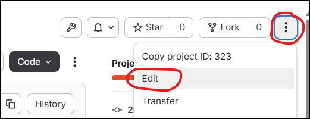

# Nastavení viditelnosti repozitáře v GitLabu:

- **Private**: (Výchozí) Pouze vlastník a pozvaní členové. 
- **Internal**: Přístup mají přihlášení uživatelé GitLabu.
- **Public**: Repozitář může zobrazit kdokoliv.

