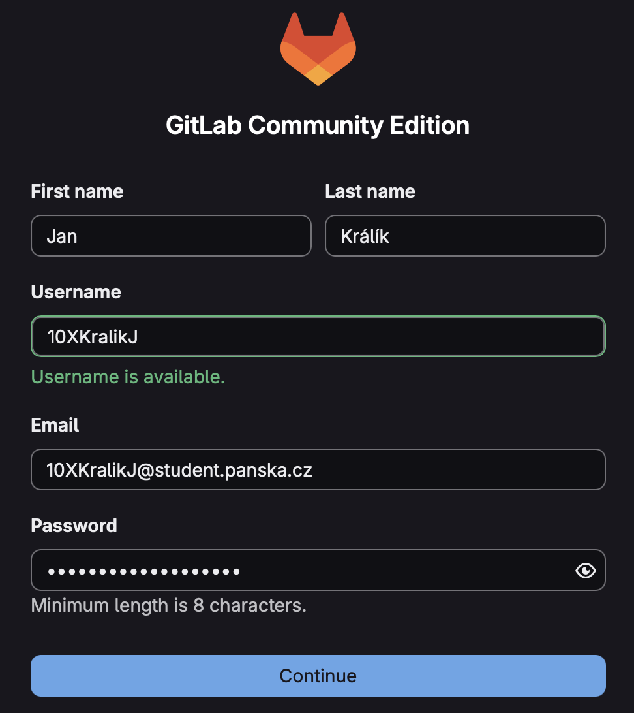

# GitLab

GitLab je komplexní platforma pro správu zdrojového kódu založená na systému Git. Umožňuje efektivní spolupráci na projektech díky verzování kódu, přehledné historii změn (commity) a dalším nástrojům pro organizaci práce. Z hlediska běžného používání je funkčně velmi podobný službě GitHub a pracuje se v něm na stejných principech.

Umožňuje:

- ukládat repozitáře na server,
- zálohovat zdrojové kódy,
- spolupracovat v týmu,
- spravovat přístupová oprávnění,
- vytvářet **Issues** a **Merge Requests**.

Pro výukové účely ve škole používáme vlastní server s platformou **GitLab Community Edition** (GitLab CE), který nám poskytuje plnou kontrolu nad projekty i uživatelskými účty a **umožňuje bezpečnou práci v interním školním prostředí**.

🌐 Školní instance: **[https://gitlab.panska.cz](https://gitlab.panska.cz)**

Poznámky: 

- Nezaměňovat s `gitlab.com`! To je komerční verze stejně jako GitHub.
- Pro práci se školním GitLabem není potřeba instalovat GitLab. Stačí mít nainstalovaný Git a vytvořený účet na `gitlab.panska.cz`.

## Vytvoření účtu

1. Otevřít: [https://gitlab.panska.cz](https://gitlab.panska.cz)
2. Zvolit registraci.
3. Vyplnit:

   - jméno a příjmení,
   - uživatelské jméno **ve tvaru** `10XPrijmeniJ` (v rámci systému musí být unikátní)
   - **školní e-mail** `10XPrijmeniJ@student.panska.cz` (jiný než školní nebude fungovat)
   - vhodné heslo, klidně vaše školní.

4. Potvrdit registrační e-mail.

---

Jakmile pochopíte základní principy práce v GitLabu, budete se umět bez potíží orientovat i na GitHubu. Obě služby totiž fungují na stejném systému Git a práce s nimi je v podstatě totožná. Naučíte se pracovat s repozitáři, ukládat změny, vracet se v historii a spolupracovat s ostatními, a tyto dovednosti pak můžete použít kdekoliv jinde. Rozdíly mezi GitLabem a GitHubem jsou hlavně v ovládání a v některých doplňkových funkcích, které pro základní použití nejsou podstatné. Co se naučíte zde, není vázané na jednu konkrétní službu, ale obecná a přenositelná dovednost. Vše navíc probíhá v bezpečném školním prostředí.

## Názvy větví

⚠️ Toto se často plete!

**main**, **master**

Jsou to názvy větví. Nic víc.
- `master` - původní historický "Linusův" název hlavní větve v Gitu.
- `main` - novější, dnes doporučovaný název hlavní větve. Změna se týká jen defaultního názvu, Git jako takový se nijak nezměnil. tento název používá defaultně GitHub (od 2020) i GitLab (od 2021). Staré repozitáře zůstávají na `master`, dokud si je autor sám nepřejmenuje. Není to v žádném případě povinné!

**origin**

- `origin` není větev, ale **název vzdáleného repozitáře**. Je to alias (přezdívka) pro URL serveru.
- I tento název vymyslel Linus Torvalds a naštěstí nikmu nevadí, takže se nezměnil.
- `origin` je `https://gitlab.panska.cz/jmeno/projekt.git`

Když napíšete `git push origin main` znamená to: "Pošli větev `main` na vzdálený repozitář jménem `origin`.

**origin/main**

-  `main` je moje lokální větev.
-  `origin/main` je kopie hlavní větve na serveru.

Vysvětlení: `origin/main` je informace, jak vypadá `main` na serveru. Nelze do ní přímo commitovat, je to jen "zrcadlo".

**Shrnutí:**

- `main` je moje větev, 
- `origin` je server,
- `origin/main` je to, co na něm vidím já (nebo i ostatní).

